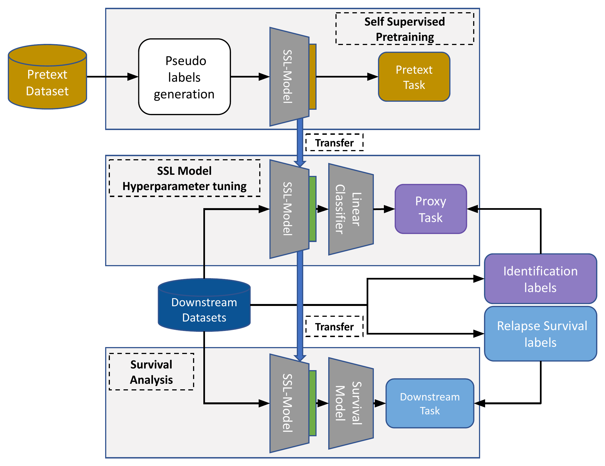

# Relapse Prediction from Long-Term Wearable Data Using Self-Supervised Learning and Survival Analysis

<div align="center">

[](https://ieeexplore.ieee.org/document/10096277)
[](https://robotics.ntua.gr/wp-content/uploads/sites/2/Fekas_ICASSP2023_paper.pdf)

[](https://pytorch.org/)
[](https://github.com/astral-sh/uv)
[](https://github.com/astral-sh/ruff)
[](https://mypy.readthedocs.io/en/stable/)
[](LICENSE)

</div>

<p align="center">
  
</p>

## Expected Data Format

The clinical wearable dataset used in the paper is protected medical data and is not included in this repository. To run on your own data, provide inputs in the following format:

| Input | Shape / Columns | Description |
|---|---|---|
| `pretext_x` / `downstream_x` | `(S, 10, L)` `float32` | `L` in `{240, 480, 720}` (4h/8h/12h at 1 min); channels: `linacc_xyz, gyr_xyz, hr, rr, hour_sin, hour_cos` |
| `event`, `time_days` | `(S_down,)` | Right-censoring indicator (`bool`) and days to next relapse or censoring (`float64`) |
| `metadata.csv` | `user_id, timestamp, event, time_days, past_episodes, last_episode_level, last_episode_psychotic` | Window-level survival targets and prior-episode history |
| `static_features.csv` | Indexed by `user_id` | Optional baseline numeric/categorical covariates |

## Repository Structure

```text
├── assets/methodology.png           # Framework overview diagram
├── configs/                         # 4h / 8h / 12h SSL & survival YAML configs
├── scripts/
│   ├── generate_synthetic_data.py   # Synthetic (S, 10, L) wearable + survival bundle
│   ├── pretrain_ssl.py              # Pretrain TFC, TS-TCC, or Mixing-Up (+ ablations)
│   ├── evaluate_person_id.py        # Proxy Person Identification linear probe (Table 2)
│   ├── run_survival_analysis.py     # 4-model survival benchmark & risk stratification
│   └── reproduce_paper_figures.py   # Reproduce Figs. 1-4 & Tables 2-3 end-to-end
├── src/relapse_prediction/
│   ├── data/                        # Preprocessing, augmentations, datasets, synthetic generator
│   ├── models/                      # TFC, TS-TCC, Mixing-Up, MiniRocket, linear probe
│   ├── losses/                      # NTXent, NTXentPoly, MixUp, CoxPH, MTLR losses
│   ├── survival/                    # DeepSurv, Neural MTLR, tree ensembles, covariates
│   ├── training/ & evaluation/      # SSL trainers, C-index, IPCW Brier/IBS, risk tiers
│   └── utils/                       # IEEE/SciencePlots & Altair figure generators
└── tests/                           # Pytest unit, figure-export, and smoke tests
```

## Quickstart

```bash
# 1. Install dependencies
uv sync

# 2. Generate synthetic 4-hour wearable + survival data
uv run python scripts/generate_synthetic_data.py \
    --window-hours 4 --n-pretext-users 20 --n-downstream-users 14 \
    --samples-per-user 30 --output-dir outputs/synthetic_4h

# 3. Pretrain SSL encoder (tfc | tstcc | mixing_up)
uv run python scripts/pretrain_ssl.py \
    --method tfc --config configs/ssl/tfc_4h.yaml \
    --data-dir outputs/synthetic_4h --epochs 5 --output-dir outputs/runs/tfc_4h

# 4. Proxy task: Person Identification linear probe
uv run python scripts/evaluate_person_id.py \
    --data-dir outputs/synthetic_4h \
    --embeddings outputs/runs/tfc_4h/downstream_embeddings.npy --min-samples-per-user 10

# 5. Downstream survival benchmark & risk-tier figures
uv run python scripts/run_survival_analysis.py \
    --data-dir outputs/synthetic_4h \
    --embeddings outputs/runs/tfc_4h/downstream_embeddings.npy \
    --static --past-episodes --epochs 30 --n-trees 50 \
    --save-figures-dir outputs/runs/tfc_4h/figures

# 6. Reproduce all paper figures (Figs. 1-4) & Tables 2-3 on synthetic data
uv run python scripts/reproduce_paper_figures.py --output-dir outputs/paper_figures --fast

# 7. Run tests, linter, and strict type checks
uv run pytest && uv run ruff check . && uv run mypy src scripts tests
```

## Credits

| Method | Paper | Upstream Code |
|---|---|---|
| **TS-TCC** | [arXiv:2106.14112](https://arxiv.org/abs/2106.14112) | [emadeldeen24/TS-TCC](https://github.com/emadeldeen24/TS-TCC) |
| **Mixing-Up** | [arXiv:2203.09270](https://arxiv.org/abs/2203.09270) | [Wickstrom/MixupContrastiveLearning](https://github.com/Wickstrom/MixupContrastiveLearning) |
| **TFC** | [arXiv:2206.08496](https://arxiv.org/abs/2206.08496) | [mims-harvard/TFC-pretraining](https://github.com/mims-harvard/TFC-pretraining) |
| **Wearable Augmentations** | [arXiv:1706.00527](https://arxiv.org/abs/1706.00527) | [terryum/Data-Augmentation-For-Wearable-Sensor-Data](https://github.com/terryum/Data-Augmentation-For-Wearable-Sensor-Data) |

## Citation

```bibtex
@inproceedings{10096277,
  author    = {Fekas, E. and Zlatintsi, A. and Filntisis, P. P. and Garoufis, C. and Efthymiou, N. and Maragos, P.},
  booktitle = {ICASSP 2023 - 2023 IEEE International Conference on Acoustics, Speech and Signal Processing (ICASSP)},
  title     = {Relapse Prediction from Long-Term Wearable Data Using Self-Supervised Learning and Survival Analysis},
  year      = {2023},
  pages     = {1-5},
  doi       = {10.1109/ICASSP49357.2023.10096277}
}
```
